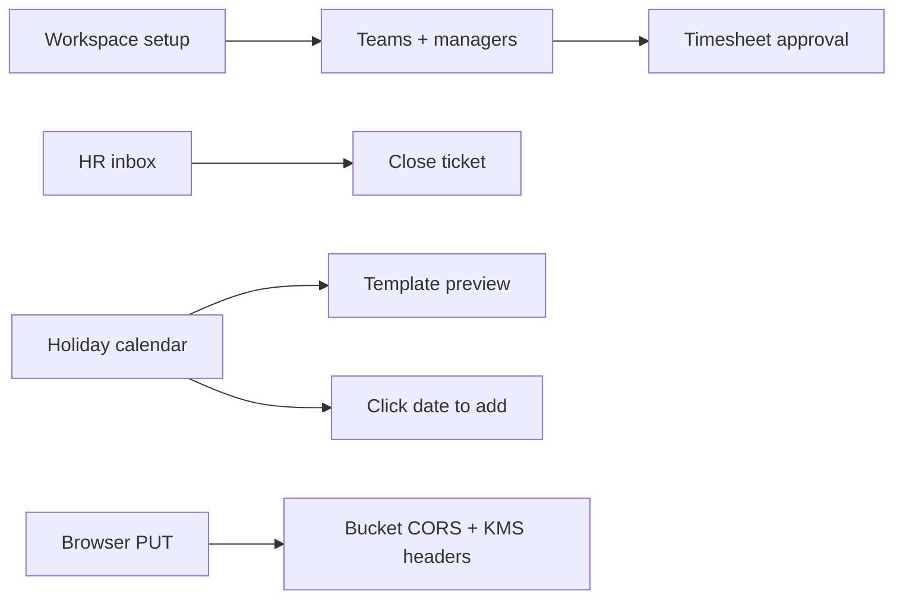

# HR, setup, holidays, timesheets, S3

Work **one phase at a time**. After a phase is merged and you have checked it, say continue for the next. Do not start the following phase in the same pass.

| Phase | Feature | Stop when |
| --- | --- | --- |
| 1 (now) | HR can close tickets | Close from the thread header; closed tickets stay in inbox |
| 2 | Cannot type in Setup | Workplace name/address type with the map visible |
| 3 | Setting up teams | Named teams under a chosen department; people bound on launch |
| 4 | 0..n department managers | Two managers on one dept, none on another |
| 5 | Timesheet approval | Approve/reject persists; rejected rows remain |
| 6 | Timesheet log/schedule for multiple people | One action creates one row per person |
| 7 | Project board multi-assignee | Stacked avatars; both assignees see the card |
| 8 | Holiday template preview + approval | Preview dates; apply as pending |
| 9 | Holiday date selection | Click a desktop day to add that date |
| 10 | S3 CORS | Browser PUT no longer fails preflight |
| 11 | Priority colors | Low/medium/high/urgent chips on HR tickets |

---

## Phase 1 only (implement first)

Do not touch setup, holidays, S3, timesheets, or projects until Phase 1 is done.

---

## 1. HR must be able to close tickets

**Problem:** Closing only lives in the details drawer, which starts **closed** (`detailsOpen` defaults to `false` in [hrsolutions/src/app/chat/page.tsx](hrsolutions/src/app/chat/page.tsx)). HR never sees the status `<select>` in [HrTicketPanel.tsx](hrsolutions/src/components/chat/HrTicketPanel.tsx). Inbox also defaults to `status=open`, so a closed ticket vanishes and looks like the action failed.

**Changes:**
- Auto-open the details panel when the selected conversation is `hr_ticket`.
- Add **Resolve** and **Close** actions on the thread header (and keep the status select). Call existing `updateHrTicket({ status })`.
- After close, keep the ticket in inbox: default inbox filter to `all` or add a Closed chip; do not drop it from the list until the user filters it away.
- Treat role `'hr'` the same as `'hr_manager'` in [useChat.tsx](hrsolutions/src/hooks/useChat.tsx) `HR_ROLES` and [chat.service.ts](app/src/modules/chat/chat.service.ts) `isHrRole`.
- Closed tickets stay read-only in the composer (already true).

---

## 2. Setting up teams

**Problem:** Setup step 2 is labeled “Teams and job roles” but only saves **departments + job titles**. Real `teams` rows are created only at launch as `"{Department} Team"` in [setup.controller.ts](app/src/modules/setup/setup.controller.ts) `applySetupAssignments`. Settings → add team always attaches to the **first** department ([EmployeeSettingsView.tsx](hrsolutions/src/components/modules/EmployeeSettingsView.tsx) `handleAddTeam`). Missing teams also breaks manager scope used by timesheet approval.

**Changes:**
- On Structure step, add a **Teams** list: name + department. Persist via `POST /org/teams` (or extend `/setup/departments` to accept `teams: [{ name, department }]`).
- On Review, assign people to a **team** (not only department) and pass `assignments` with real team names, not only `{department} Team`.
- Launch: send pending employees **and** assignments in one `saveTeam` call (today launch uses `employees: []`, so people invited on step 4 are not re-bound).
- Settings: require a department picker when creating a team; stop defaulting to `deptRows[0]`.
- **0..n department managers** (backend already replaces leads via `department_leads` / empty list clears — [orgLeads.ts](app/src/utils/orgLeads.ts)):
  - Setup Review: keep adding multiple managers; allow **no manager**; pick from any invited person (today the dropdown only lists owner + that department’s members).
  - Launch still calls `setDepartmentLeads` with whatever emails were chosen, including `[]`. Create the department team even when there is no lead. Members with no manager keep `reporting_manager_id` null (HR/admin remain the approvers).
  - Settings `ManagerPicker`: empty state copy **“No manager”**; removing the last chip must save `leadEmployeeIds: []` (already the API contract). Do not require a manager to save the department.

---

## 3. Cannot type in Setup

**Problem:** Workplace fields sit next to Leaflet. Map panes use high z-index and the canvas is not clipped, so the map steals clicks/focus from name/address inputs ([SetupWorkplaceStep.tsx](hrsolutions/src/components/modules/setup/SetupWorkplaceStep.tsx), [workspace-setup.css](hrsolutions/src/components/modules/setup/workspace-setup.css) `.setup-location__map`).

**Changes:**
- `.setup-location__map` / `.setup-location__map-canvas`: `position: relative; overflow: hidden; isolation: isolate; z-index: 0`.
- Field column: `position: relative; z-index: 1`.
- Invalidate Leaflet size after layout (`map.invalidateSize()`) so tiles stay inside the box.
- Confirm department / people inputs still receive keystrokes after the map fix (they share the same wizard).

---

## 4. Fix timesheet approval

**Problem:** Approval is a generic `PATCH` that only checks `canAccessEmployee` ([projects.controller.ts](app/src/modules/projects/projects.controller.ts) `updateTimesheet` / `bulkUpdateTimesheets`). Owners can access their own rows; managers fail when `team_id` / reporting lines were never created (item 2). Reject in the UI **deletes** rows locally ([TimesheetsModule.tsx](hrsolutions/src/components/modules/TimesheetsModule.tsx) `handleBatchReject`) so status does not stick. `approvedBy` is stored as UUID and shown as a name until refresh.

**Changes:**
- Treat `status: Approved | Rejected` as a **decision**: only org-wide HR/admin, reporting/team lead, or project manager; never the owner.
- Do not set `approver_id` on ordinary hour/description edits.
- Keep rejected entries (`status: rejected`); do not splice them out of client state.
- Return `approver_name` from the API and map it in `mapApiTimesheet`.
- Surface API errors in a toast instead of `alert`, and disable Approve when `reviewablePeriodEntries` is empty with a short reason (no team / not a manager).

---

## 5. Holiday templates: preview and approval

**Problem:** Applying templates writes holidays as `isApproved: true` immediately ([HolidayCalendarView.tsx](hrsolutions/src/components/modules/attendance/HolidayCalendarView.tsx) `handleApplySelectedTemplates`). The modal only lists template names, not dates.

**Changes:**
- In the template modal, show a scrollable **preview** of `selectedTemplateItems` (date, weekday, name, clash vs existing).
- Default apply to **Pending** (`isApproved: false`). Optional “Apply and approve” for HR.
- After apply, jump the calendar to the first preview date and keep the pending filter visible.
- Employees still only see `isApproved !== false` (already filtered).

---

## 6. Holiday date selection

**Problem:** Desktop month cells are not clickable; only chips and the mobile grid select a date. Adding a holiday always uses today / month-start, not the clicked day.

**Changes:**
- Desktop cell click (empty area) sets the selected date and opens Add Holiday with that `YYYY-MM-DD`.
- Clicking a chip still opens the detail/approve modal.
- Bound the date input to the active year; store/display dates as calendar dates (keep `holiday_date::text` on GET; avoid `toISOString()` in [mapHolidayRow](app/src/modules/attendance/attendance.controller.ts) fallback).

---

## 7. Fix CORS policy on S3

**Problem:** Browser `PUT` to a presigned URL ([apiClient.ts](hrsolutions/src/services/apiClient.ts) `uploadFileToS3`) sends `Content-Type`. The signed command also sets `ServerSideEncryption: 'aws:kms'` ([s3.ts](app/src/config/s3.ts)). Bucket CORS in [docs/s3-setup-plan.md](docs/s3-setup-plan.md) does not allow the KMS header, which fails the preflight.

**Changes:**
- Add a one-shot script (e.g. `app/src/scripts/applyS3Cors.ts`) using `PutBucketCorsCommand` with:
  - `AllowedMethods`: `GET`, `PUT`, `HEAD`
  - `AllowedHeaders`: `Content-Type`, `x-amz-server-side-encryption`, `x-amz-server-side-encryption-aws-kms-key-id`, `x-amz-*`
  - `AllowedOrigins`: `http://localhost:3000` plus `FRONTEND_ORIGIN` / production host
  - `ExposeHeaders`: `ETag`
- If the signed URL includes SSE-KMS, send the same header on the browser PUT (or drop SSE from the signed PUT and rely on bucket default encryption so the browser only needs `Content-Type`).
- Keep the documented checklist; do not put AWS keys in the frontend.

---

## 8. Colors for priority

**Problem:** Ticket priority is plain text in the list, panel, and new-request dialog. No color coding.

**Changes:**
- Add `ticketPriorityClass()` next to `ticketStatusClass` in [chatUi.tsx](hrsolutions/src/components/chat/chatUi.tsx):
  - Low: slate
  - Medium: blue
  - High: amber
  - Urgent: rose
- Use chips in [ConversationList](hrsolutions/src/components/chat/ConversationList.tsx), [HrTicketPanel](hrsolutions/src/components/chat/HrTicketPanel.tsx), and [NewHrRequestDialog](hrsolutions/src/components/chat/NewHrRequestDialog.tsx).
- Reuse the same four classes for task priority chips if they appear next to timesheet rows; Projects already has colored badges.

---

## 9. Timesheets: schedule or log for multiple people

**Problem:** The log/schedule modal uses a single `formEmployeeId` ([TimesheetsModule.tsx](hrsolutions/src/components/modules/TimesheetsModule.tsx)). Managers can only create one row at a time.

**Changes:**
- Toolbar button **Schedule / log for people** (visible to HR, admin, and managers) opens the same Task | Schedule modal with a **multi-select people** chip picker (same pattern as `ManagerPicker`). Default to the current filter employee if one is selected; otherwise start empty and require at least one person.
- On save, create **one timesheet per selected employee** (same title, times, project/task). Loop existing `api.projects.createTimesheet` unless a small bulk create is cheaper; do not share one row across people.
- Editing an existing entry stays single-person.
- Respect `canAccessEmployee` / team scope: only people the actor can manage appear in the picker.

---

## 10. Project board: assign a task to more than one person

**Problem:** Tasks have a single `assigned_to_employee_id` / `assigneeId` ([types.ts](hrsolutions/src/types.ts) `Task`, [projects.controller.ts](app/src/modules/projects/projects.controller.ts), create-task dropdown `newTaskAssignee`).

**Changes:**
- Add `project_task_assignees (task_id, employee_id, is_primary)` (ensure on read/write like other extra columns). Keep `assigned_to_employee_id` as the **primary** assignee for old queries and reports.
- API create/update accept `assignedToEmployeeIds: string[]` (empty = unassigned). GET returns `assignedToEmployeeIds` + names; [backendSync.ts](hrsolutions/src/services/backendSync.ts) maps to `assigneeIds` / `assigneeNames` while keeping `assigneeId` / `assigneeName` as the primary.
- Board create/edit: multi-select instead of one `<select>`. Cards show stacked avatars; search/filter matches any assignee.
- Permissions / timer / clock-in: any assignee (or a manager of any assignee) can move the card and start the timer. “Must be clocked in” is satisfied if **any** assignee is clocked in.
- Dashboard / Gantt / timesheet task pickers treat the current user as assigned if they are in `assigneeIds`.

---

## Verification (Phase 1)

- Chat as HR: open a request, **Close** from the thread header without opening details.
- Composer locks; ticket remains in HR Inbox under Closed / All.
- Status still updates via the details panel select if the drawer is open.

Later phases keep their own checks from the sections above. Do not run them until that phase starts.
