# Persistence Integrity — Phased Fix Plan

## Overview

A four-phase remediation to restore end-to-end frontend→backend persistence: delete unused CRM/Notes/Finance surfaces, stop silent false-success and localStorage domain leaks, close HR/settings/setup contracts, complete attendance/projects/audit APIs, then clean auth and gate any remaining unwired modules.

## Goal

Make every business mutation either (a) succeed on the real backend and then update UI, or (b) fail visibly with no UI drift. Browser storage must hold only auth credentials and UI preferences (theme). Unused product surfaces (CRM, Notes, Finance) are **removed from the app**, not stubbed or gated.

```mermaid
flowchart LR
  subgraph phase1 [Phase 1 Foundation]
    R[Delete CRM Notes Finance]
    A[apiClient throws on failure]
    B[store UI-only]
    C[settings via org APIs]
  end
  subgraph phase2 [Phase 2 HR Contract]
    D[setup settings endpoints]
    E[wizard integrity]
    F[setupTeam transactions]
  end
  subgraph phase3 [Phase 3 Domain APIs]
    G[projects timesheets]
    H[attendance extras]
    I[audit-comms]
  end
  subgraph phase4 [Phase 4 Auth and leftovers]
    J[gate Inventory Recruitment Support]
    K[student and admin auth]
  end
  phase1 --> phase2 --> phase3 --> phase4
```

## Checklist

- [x] Phase 1: Delete CRM, Notes, Finance modules and all nav/settings/apiClient/App references
- [x] Phase 1: apiClient throws on failure; strip LOCAL_STORAGE_ONLY; store.ts UI-only hydrate/persist
- [x] Phase 1: Rewire Employee/Attendance settings structural CRUD to api.org.*; fix wizard false-success paths
- [x] Phase 2: Add tenant_settings + setup settings routes; hydrate in backendSync; wire payroll/attendance/employment/onboarding/general
- [x] Phase 2: setupTeam DB transaction; register compensating cleanup; org delete/update where settings need them
- [x] Phase 3: Implement missing projects/timesheet, attendance, and audit-comms routes to match apiClient
- [x] Phase 4: Gate remaining unwired modules (Inventory/Recruitment/Support); fix student/master auth; remove AuthService.login fake tokens

---

## Phase 1 — Foundation (remove dead surfaces + stop lying to the UI)

**Outcome:** CRM/Notes/Finance gone from the product; failed API calls never look like success; localStorage no longer rehydrates domain data.

### 1.0 Delete unused CRM, Notes, and Finance

These have **no Next.js app routes** and only appear in the legacy shell / projects tab / settings toggles. Remove them entirely (do not hide behind a flag).

**Delete module files:**

- [`hrsolutions/src/components/modules/CRMModule.tsx`](../hrsolutions/src/components/modules/CRMModule.tsx)
- [`hrsolutions/src/components/modules/NotesModule.tsx`](../hrsolutions/src/components/modules/NotesModule.tsx)
- [`hrsolutions/src/components/modules/FinanceModule.tsx`](../hrsolutions/src/components/modules/FinanceModule.tsx)

**Strip imports and switch cases:**

- [`hrsolutions/src/App.tsx`](../hrsolutions/src/App.tsx) — remove `crm` / `finance` / `project_notes` cases and imports
- [`hrsolutions/src/components/modules/ProjectsModule.tsx`](../hrsolutions/src/components/modules/ProjectsModule.tsx) — remove Notes tab (`activeTab === 'notes'`) and `NotesModule` import
- [`hrsolutions/src/components/layout/AppShell.tsx`](../hrsolutions/src/components/layout/AppShell.tsx) — remove `project_notes` → `/notes` path mapping
- [`hrsolutions/src/components/layout/Sidebar.tsx`](../hrsolutions/src/components/layout/Sidebar.tsx) — remove notes/`project_notes` active-id alias
- [`hrsolutions/src/data/initialData.ts`](../hrsolutions/src/data/initialData.ts) — remove `crm` / `finance` / `project_notes` from role→module maps (keep `finance_manager` role if still used for payroll permissions, but do not grant a finance module)
- Note: the separate `SettingsModule` was removed; access/feature catalog edits are no longer a live UI surface

**Remove dead API client namespaces:**

- [`hrsolutions/src/services/apiClient.ts`](../hrsolutions/src/services/apiClient.ts) — delete `api.finance`, `api.crm`, `api.notes` blocks (no backend routers exist)

**Do not remove:** payroll HR flows (`api.payroll`), Documents, Announcements, or meeting-summarize AI helpers that only use the word "notes" in copy.

### 1.1 Make `apiClient` fail loudly

In [`hrsolutions/src/services/apiClient.ts`](../hrsolutions/src/services/apiClient.ts):

- Change `request()` so `!response.ok || !data.success` **throws** an `Error` with `code`/`message` (keep existing `ApiResponse` shape available via a new `requestRaw` only if needed).
- Remove the live stub path: delete or hard-gate `LOCAL_STORAGE_ONLY` so it cannot return fake `{ success: true }`.
- Keep Bearer + `X-Tenant-ID` attachment as-is.

### 1.2 LocalStorage hygiene

In [`hrsolutions/src/services/store.ts`](../hrsolutions/src/services/store.ts):

- `saveStoredState`: persist only `{ activeModule, customOptions: { featureToggles } }`. Drop `notifications`, `currentPersona`, and any business keys.
- `loadStoredState`: merge only `featureToggles` from storage; never spread full `parsed.customOptions`. Always force business arrays empty (already mostly done).
- One-time cleanup on load: `localStorage.removeItem('ACME_BOS_STATE_FRESH_V1')` and strip unknown keys from `PIXBE_BOS_STATE_V1`.

Persona continues to come from [`backendSync.ts`](../hrsolutions/src/services/backendSync.ts) `/auth/me` + `AuthService` session token storage (allowed).

### 1.3 Remap structural settings to existing org APIs

Do **not** invent new tables yet for departments/offices/teams/roles. Rewire callers to APIs that already exist in [`app/src/modules/org/`](../app/src/modules/org/):

| UI action | Call |
|---|---|
| Add office | `api.org.createOffice({ name, code, address, latitude, longitude, geofenceRadiusMeters })` |
| Add department | `api.org.createDepartment({ name, code })` |
| Add team | `api.org.createTeam({ departmentId, name })` |
| Add job role | `api.org.createJobRole({ title, code, departmentId? })` |

Primary file: [`EmployeeSettingsView.tsx`](../hrsolutions/src/components/modules/EmployeeSettingsView.tsx)

- Await API → on success only `onUpdateState`.
- On throw: toast error; leave prior state.
- Delete/edit paths that only send string arrays to `/setup/*` must either call org create with correct shape or be deferred to Phase 2 delete endpoints if missing.

Same pattern for office saves in [`AttendanceSettingsView.tsx`](../hrsolutions/src/components/modules/AttendanceSettingsView.tsx) (geofence fields map to `createOffice` / a Phase-2 org update if needed).

### 1.4 Fix callers that swallow errors

- [`ProjectsModule.tsx`](../hrsolutions/src/components/modules/ProjectsModule.tsx): replace `.catch(() => {})` with toast + no optimistic commit (or rollback).
- [`EmployeeSetupWizard.tsx`](../hrsolutions/src/components/modules/EmployeeSetupWizard.tsx): persist first; only update Context + success toast when creates succeed; surface `allSettled` rejections.
- [`WorkspaceSetupWizard.tsx`](../hrsolutions/src/components/modules/setup/WorkspaceSetupWizard.tsx): on catch, **do not** advance step; keep `persistSetupStep` success gate; POST each office (loop), not only `[0]`.

**Phase 1 exit criteria:** No CRM/Notes/Finance files or nav entries remain; settings office/dept/role create survives hard refresh; intentional backend kill shows error toast and UI unchanged; `PIXBE_BOS_STATE_V1` contains no employees/departments/notifications/persona.

---

## Phase 2 — Setup / settings persistence + DB integrity

**Outcome:** Non-org settings (employment types, onboarding fields, general/payroll/attendance policy blobs) persist; multi-entity setup is transactional.

### 2.1 Tenant settings store (single backend surface)

Add a small key/value (or JSON document) persistence layer in the tenant schema, exposed under existing setup router:

- Routes in [`app/src/modules/setup/setup.routes.ts`](../app/src/modules/setup/setup.routes.ts):
  - `POST /setup/employment-types`
  - `POST /setup/onboarding-fields`
  - `POST /setup/general`
  - `POST /setup/payroll`
  - `POST /setup/attendance`
  - `GET /setup/settings` (hydrate all keys for sync)

- Controller writes upsert into e.g. `tenant_settings(key TEXT PRIMARY KEY, value JSONB)`.
- Migration via existing [`app/src/db/migrator.ts`](../app/src/db/migrator.ts) tenant DDL.

Frontend: point [`apiClient.setup.*`](../hrsolutions/src/services/apiClient.ts) (already declared) at these routes; wire [`PayrollSettingsView.tsx`](../hrsolutions/src/components/modules/PayrollSettingsView.tsx) and attendance policy save in [`AttendanceSettingsView.tsx`](../hrsolutions/src/components/modules/AttendanceSettingsView.tsx) to rely on Phase-1 throw semantics.

Hydrate in [`backendSync.ts`](../hrsolutions/src/services/backendSync.ts) via `GET /setup/settings` into `customOptions`.

### 2.2 Fix remaining setup payload mismatches

- Settings “delete office/dept” that currently POST string lists: implement org DELETE routes **or** soft-deactivate via PATCH; do not fake delete with `/setup/office { offices: [] }`.
- [`setup.controller.ts` `setupTeam`](../app/src/modules/setup/setup.controller.ts): wrap employee inserts + onboarding status advance in `BEGIN`/`COMMIT`/`ROLLBACK`. Cognito provision failures: mark row with `auth_error` but keep transaction consistent for DB rows; return partial success payload the UI can show.

### 2.3 Register path hardening

In [`auth.controller.ts`](../app/src/modules/auth/auth.controller.ts): add compensating cleanup (delete tenant row / mapping) if schema provision or admin seed fails after control-plane `COMMIT`, or document and implement a single extended transaction where feasible.

**Phase 2 exit criteria:** Employment types, onboarding fields, payroll groups, attendance policies survive refresh; setup team never leaves half-inserted employees without a 5xx; settings GET restores `customOptions` after login.

---

## Phase 3 — Close HR domain API gaps the UI already calls

**Outcome:** Frontend methods used by live HR modules match mounted Express routes.

### 3.1 Projects / timesheets

Extend [`app/src/modules/projects/`](../app/src/modules/projects/):

- `PATCH /projects/projects/:id`
- `POST /projects/tasks/bulk`
- `PATCH /projects/timesheets/:id`
- `PATCH /projects/timesheets/bulk`
- `DELETE /projects/timesheets/:id`

Align handlers with payloads already sent from [`ProjectsModule.tsx`](../hrsolutions/src/components/modules/ProjectsModule.tsx) and [`TimesheetsModule.tsx`](../hrsolutions/src/components/modules/TimesheetsModule.tsx).

### 3.2 Attendance extras

Extend [`app/src/modules/attendance/`](../app/src/modules/attendance/):

- Leave: `PUT /leaves/:id/status`, `PUT /leaves/bulk-status`, `DELETE /leaves/:id` (**implement routes** to match current FE).
- `POST /regularizations`, `PUT /regularizations/:id/status`
- `PUT /records/:id`, `POST /break`

### 3.3 Audit / announcements

Extend [`app/src/modules/audit-comms/`](../app/src/modules/audit-comms/):

- Announcement react / comment / pin / delete routes matching [`apiClient.auditComms`](../hrsolutions/src/services/apiClient.ts).
- Notification mark-all / clear / delete under `/audit-comms/notifications/...`.
- Remove or redirect dead `/notifications/*` aliases in the client to the audit-comms paths.

**Phase 3 exit criteria:** Timesheet approve/reject, project approval, leave regularization, and announcement pin/delete persist across refresh with no 404s in network tab.

---

## Phase 4 — Remaining unwired modules + auth cleanup

**Outcome:** No remaining memory-only product modules in nav; demo/fake auth paths removed.

### 4.1 Gate (or delete) leftover unwired surfaces

CRM / Notes / Finance are already gone in Phase 1. For other unused local-only modules still in the legacy shell:

- Hide or delete: Inventory, Recruitment, Support
- Communication: keep only if still linked from a live Next route; otherwise remove the same way as CRM (legacy `App.tsx` switch only)

Files: [`Sidebar.tsx`](../hrsolutions/src/components/layout/Sidebar.tsx), [`App.tsx`](../hrsolutions/src/App.tsx).

No follow-up backend for CRM/Notes/Finance — they are removed permanently in this plan.

### 4.2 Student + master-admin auth

**Confirmed:** Students do **not** use Cognito. Credentials are DB-backed: `students.password_hash` (PBKDF2) in the tenant schema; session is an app JWT via `api.setAuth` only. Staff stay on Cognito.

- Backend: `POST /auth/student-login` — lookup `students` by email/roll/`student_id`, `verifyPassword` against `password_hash`, `signJwt` with `role: 'student'`; extend [`auth.middleware.ts`](../app/src/middleware/auth.middleware.ts) to accept that JWT.
- Enroll: default `password_hash` to hashed roll number when password omitted ([`institute.controller.ts`](../app/src/modules/institute/institute.controller.ts)).
- [`StudentLoginView.tsx`](../hrsolutions/src/components/auth/StudentLoginView.tsx): call student-login; store token via `api.setAuth` only; remove demo bypasses and `BOS_STUDENT_AUTH` PII blob.
- [`MasterAdminDashboard.tsx`](../hrsolutions/src/components/modules/master-admin/MasterAdminDashboard.tsx): replace `localStorage master_admin_authenticated` with control-plane session / role check.
- [`authService.ts`](../hrsolutions/src/services/authService.ts): remove `login()` fake `dev_*` token helper; keep session set/logout/getSession (works for both Cognito and student JWT).

### 4.3 Legacy shell

- [`hrsolutions/src/App.tsx`](../hrsolutions/src/App.tsx): after module deletion, ensure it does not reintroduce full-state localStorage persistence if still shipped; prefer Next `AppContext` path only.

**Phase 4 exit criteria:** Nav only shows modules with working persistence; student/master auth cannot be forged via localStorage flags; no `dev_` tokens; zero references to `CRMModule` / `NotesModule` / `FinanceModule`.

---

## Testing strategy (every phase)

1. Hard refresh after each mutation (and Playwright helper that clears `PIXBE_BOS_STATE_V1` — see [`hrsolutions/e2e/support/persistence.ts`](../hrsolutions/e2e/support/persistence.ts)).
2. DevTools → Application → Local Storage: only auth keys + theme toggles.
3. Network: mutation returns 2xx; stop backend → UI error, no state change.
4. Smoke: register → workspace setup wizard → employee settings → attendance punch/leave → timesheet approve.
5. Grep/`tsc`: no imports of deleted CRM/Notes/Finance modules; no `/crm` `/finance` `/notes` API client methods.

## Out of scope for this plan

- Full Cognito/S3 production hardening beyond persistence correctness.
- Rebuilding CRM, Notes, or Finance product modules (removed, not deferred).
